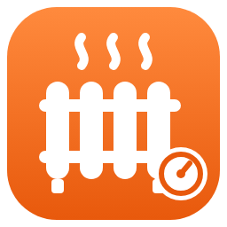

# Habidat (ista España) para Home Assistant

Integración no oficial que lee tus datos de **[Habidat](https://plataforma.habidat.es)**, la plataforma con la que **ista** reparte en España la calefacción central (y, según el edificio, el agua caliente o fría) entre los vecinos.

> *English below.*

## Qué da

Un aparato por vivienda y, **por cada suministro** que tenga (calefacción, ACS…):

| Sensor | Qué es |
|---|---|
| Lectura de … | Lectura del contador (kWh, m³…) |
| … último día | Consumo del último día publicado, con los últimos 30 días en los atributos |
| Fecha de lectura de … | Día al que corresponde la última lectura (Habidat publica con uno o dos días de retraso) |
| … en el periodo | Consumo desde el inicio del periodo de facturación |
| Coste estimado de … en el periodo | Consumo del periodo × precio del último recibo |
| Precio de … en el último recibo | €/kWh (o €/m³) del último recibo |
| … media diaria del mes | Tu media diaria este mes, con la del mismo mes del año pasado en los atributos |
| … media diaria por vivienda del edificio | La media del edificio repartida entre las viviendas, para compararte |
| … del edificio en el periodo | Consumo de todo el edificio en el periodo |
| … parte del edificio | Qué porcentaje del edificio es tuyo |

Y de la vivienda: **último recibo** (importe, periodo, consumos, fijos, precios y la lista de recibos en los atributos), **inicio del periodo** y **saldo** (solo en comunidades de prepago).

### Histórico y panel de Energía

Al añadirla carga **todo el histórico diario** que tenga Habidat (normalmente desde que el edificio está en la plataforma) como estadísticas a largo plazo, **cada consumo en su día**:

- `habidat:<vivienda>_<suministro>_consumo` (kWh o m³)
- `habidat:<vivienda>_<suministro>_coste` (€; los días aparecen con coste cuando se cierra el recibo de ese periodo)

**Para el panel de Energía usa esas estadísticas, no el sensor de lectura**: Habidat publica con retraso, y el sensor apuntaría el consumo al día en que se descargó. En *Ajustes → Paneles → Energía → Añadir consumo de gas* (o de agua) busca «Habidat». Para el coste, «Usar una entidad que sigue el coste total» con la estadística `_coste`.

Cada 6 horas vuelve a leer los últimos meses, así que los costes que llegan tarde se colocan solos.

## Instalación

### HACS

1. HACS → menú ⋮ → **Repositorios personalizados** → `https://github.com/J-Hollister/ha-habidat`, tipo **Integración**.
2. Busca **Habidat** e instálala.
3. Reinicia Home Assistant.
4. *Ajustes → Dispositivos y servicios → Añadir integración → Habidat* y escribe el email y la contraseña de plataforma.habidat.es.

### A mano

Copia `custom_components/habidat` en tu carpeta `config/custom_components/` y reinicia.

## Bueno saber

- Si la cuenta tiene varias viviendas, añade la integración una vez por cada una.
- Si cambias la contraseña en Habidat, Home Assistant te la pedirá de nuevo (reautenticación).
- Si la web te pide algo al entrar (aceptar condiciones, cambiar la contraseña), hazlo allí una vez: la integración no puede.
- Hay edificios con **repartidores de costes** en los radiadores en vez de contador de calor: sus «unidades» no son kWh. La integración las enseña tal cual; si es tu caso, abre una *issue* con los diagnósticos para afinarlo.
- No es tiempo real: Habidat recibe una lectura al día.

### Cómo funciona

Habidat no tiene API pública. La integración entra igual que el navegador (formulario de `login.ista.com`) y lee los mismos datos JSON que pinta la web. Tu contraseña solo se guarda en tu Home Assistant y solo se envía a `login.ista.com`. Los diagnósticos tapan los datos personales.

**Proyecto no oficial, sin relación con ista ni Habidat.** Si cambian la web, puede dejar de funcionar hasta que se adapte.

---

## English

Unofficial integration for **Habidat**, the platform ista uses in Spain to split central heating (and, in some buildings, hot or cold water) between neighbours.

- Sensors per supply: meter reading, last day, reading date, current period total, estimated cost, price on the last bill, daily average this month (and same month last year), building average per dwelling, building total and your share.
- Per dwelling: last bill (with all bills in the attributes), period start and balance (prepaid buildings only).
- Full daily history imported as long-term statistics, **each day on its own date** (`habidat:<dwelling>_<supply>_consumo` and `_coste`). Use those in the Energy dashboard rather than the meter sensor, because Habidat publishes with a delay of one or two days.

Install through HACS as a custom repository (`https://github.com/J-Hollister/ha-habidat`, type *Integration*), restart, then add **Habidat** with your plataforma.habidat.es email and password.

Not affiliated with ista or Habidat. MIT licence.
